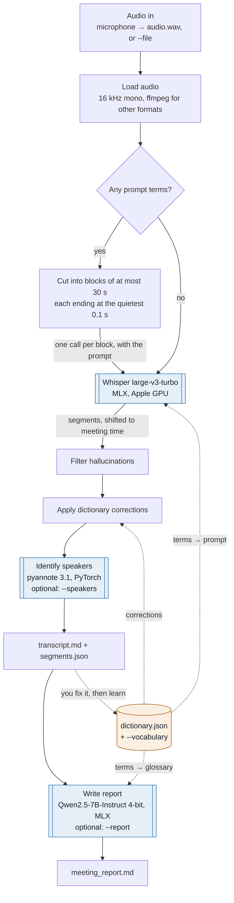
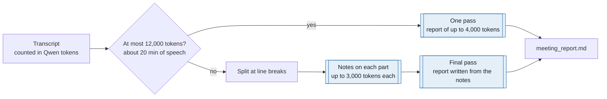
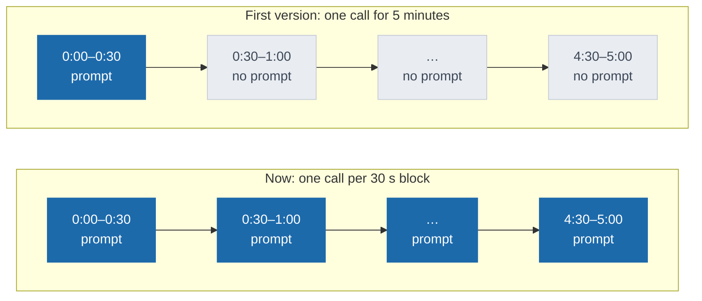
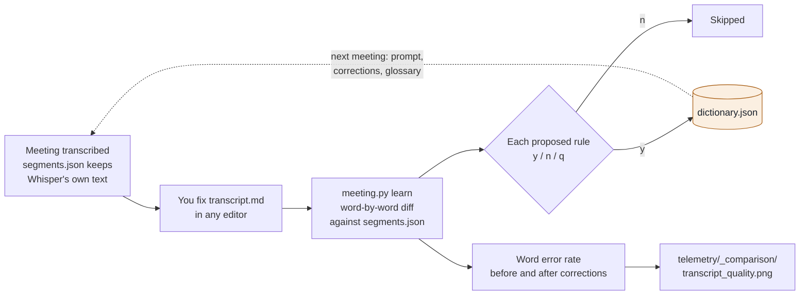
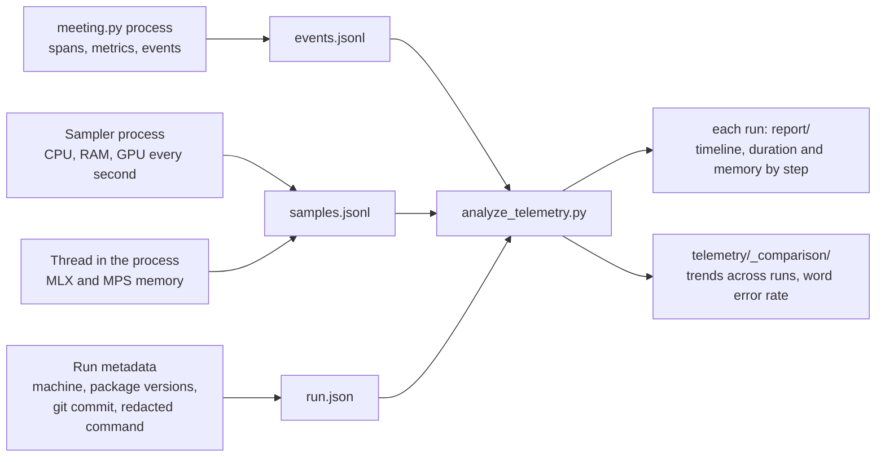

# Meeting Assistant

Local meeting assistant for macOS Apple Silicon. The project records or loads audio, transcribes it with Whisper through MLX, can identify speakers with pyannote, and can produce a detailed meeting report with a local LLM. A personal dictionary, learned from the corrections you make, improves the spelling of names and jargon over time. Audio and text remain on the machine: no remote API call is required. Hugging Face is contacted only to download each model the first time.

> **Project status**: the pipeline is designed for an Apple Silicon Mac and Python 3.13, or a version compatible with the MLX packages in use.

## Features

- recording from the microphone or transcription of an existing file;
- local transcription with `mlx-community/whisper-large-v3-turbo`, in French by default (any Whisper language, or automatic detection);
- a personal dictionary of terms and corrections, used throughout the meeting, in the correction pass and in the report;
- `meeting.py learn`, which proposes new dictionary rules from a transcript you corrected by hand;
- filtering of common Whisper hallucinations during silence, in French and English;
- optional diarization with `pyannote/speaker-diarization-3.1`;
- structured meeting reports with `mlx-community/Qwen2.5-7B-Instruct-4bit`, written in the meeting's language;
- local telemetry: duration, CPU, memory, Apple GPU, MLX/MPS memory, metrics, pipeline steps, and the word error rate of corrected transcripts;
- CSV reports and charts for analyzing runs, and an experiment to compare Whisper prompts and models.

## How it works



The dictionary acts at three points: it sets the Whisper prompt, it fixes known errors after Whisper, and it gives the report a glossary. Speaker identification and the report are optional: if either one fails, the transcript is still saved. An expected failure (missing package, refused model access, download or disk problem) prints one line; any other error also prints its traceback, because it is a bug.

### Models

| Model | Job | Runs on | When | Notes |
|---|---|---|---|---|
| `mlx-community/whisper-large-v3-turbo` | speech to text, with timestamps | MLX, Apple GPU | every run | 809 M parameters. Change it with `--whisper-model`. |
| `pyannote/speaker-diarization-3.1` | who speaks when | PyTorch, CPU | `--speakers` | Needs `HF_TOKEN` and the model's terms accepted. Change it with `--diarization-model`. |
| `mlx-community/Qwen2.5-7B-Instruct-4bit` | meeting report | MLX via `mlx-lm`, Apple GPU | `--report` | About 4 GB to download. Change it with `--llm-model`. |

Everything else is plain code: block cuts use audio energy, corrections use regular expressions, and `learn` uses a word-level diff (`difflib`).

### Steps

1. **Audio in.** From the microphone, the WAV file is written to disk continuously, so nothing is lost if the script stops. With `--file`, any format readable by `ffmpeg` is accepted.
2. **Load audio.** A mono 16 kHz WAV file is read directly; other formats and sample rates are decoded and resampled by `ffmpeg`.
3. **Cut into blocks.** Only when there are prompt terms (see [Why 30-second blocks](#why-30-second-blocks)).
4. **Whisper.** Transcribes in `--language` (`fr` by default, `auto` to detect it). `condition_on_previous_text=False` prevents repetition loops.
5. **Filter hallucinations.** Drops phrases Whisper invents during silences because it was trained on subtitled videos ("sous-titres réalisés…", "thanks for watching", "amara.org"…).
6. **Apply corrections.** Replaces the dictionary's known errors, whole words only and case-sensitive. A corrected segment keeps Whisper's text in `whisper_text`, so the effect of the corrections can be measured.
7. **Identify speakers.** pyannote finds speaker turns; each segment gets the speaker it overlaps most, renamed "Speaker 1", "Speaker 2"… `--nb-speakers` improves accuracy when known.
8. **Write the transcript.** `transcript.md` groups consecutive segments by speaker with timestamps; `segments.json` keeps every segment with start, end, text and speaker.
9. **Write the report** (see [Meeting report](#4-generate-a-meeting-report)).

## Requirements

1. An Apple Silicon Mac.
2. [Homebrew](https://brew.sh/) and `ffmpeg`:

   ```bash
   brew install ffmpeg
   ```

3. Python 3.13 recommended.
4. For microphone recording, allow microphone access for Terminal (or the application running Python) in **System Settings > Privacy & Security > Microphone**.
5. For diarization, a Hugging Face account, an access token, and acceptance of the terms for the relevant pyannote models.

## Step-by-step installation

From the repository root:

```bash
python3.13 -m venv .venv
source .venv/bin/activate
python -m pip install --upgrade pip
python -m pip install numpy psutil pandas matplotlib sounddevice soundfile
python -m pip install mlx mlx-lm mlx-whisper
python -m pip install torch pyannote.audio
```

MLX packages are specific to Apple Silicon. If installing `pyannote.audio` or PyTorch fails, first install Python and package versions compatible with the MLX environment, then rerun the last command.

Verify that the active interpreter is the virtual environment:

```bash
which python
python --version
python -c "import mlx, mlx_whisper, psutil, pandas, matplotlib"
```

Hugging Face models are downloaded automatically on first use. Plan for several gigabytes of free space, especially for the LLM.

### Enable diarization

Transcription works without a Hugging Face token. For `--speakers`:

1. create a Hugging Face token with read permissions;
2. accept the terms for `pyannote/speaker-diarization-3.1` on Hugging Face;
3. export it only in the current shell:

   ```bash
   export HF_TOKEN="hf_..."
   ```

Never add this token to Git, a tracked `.env` file, or a shared report.

## Usage

### 1. Transcribe an audio file

```bash
source .venv/bin/activate
python meeting.py --file "/path/to/meeting.m4a" --title "project-update"
```

### 2. Record from the microphone

```bash
python meeting.py --title "project-update"
```

Speak normally and press **Enter** to stop recording. The WAV file is written progressively to the meeting folder.

### 3. Add speakers

```bash
HF_TOKEN="hf_..." python meeting.py \
  --file "/path/to/meeting.m4a" \
  --speakers \
  --nb-speakers 3 \
  --title "team-meeting"
```

`--nb-speakers` is optional, but can improve accuracy when known. If diarization fails, the transcript is kept and the program continues without speaker attribution.

### 4. Generate a meeting report

```bash
python meeting.py \
  --file "/path/to/meeting.m4a" \
  --report \
  --title "team-meeting"
```

The report is generated locally with the default Qwen model. Change the model with `--llm-model` if needed.



Long transcripts are handled in two passes (map-reduce): a 7B model keeps details better over several short prompts than over one very long one. A warning is printed, and logged in the telemetry, if any output reaches its length limit.

The report has these sections, in this order: Summary, Scientific points discussed, Advice and recommendations, Research directions, References and resources mentioned, Decisions, Milestones and deadlines, TODO list (owner, deadline, priority), Open questions, Uncertain passages. The prompt forbids inventing information and asks the model to mark unclear speech recognition with `[uncertain]`.

Customize the report for a specific project or audience with `--report-context`.
This text is sent only to the local LLM together with the transcript and is
excluded from telemetry metadata:

```bash
python meeting.py \
  --file meeting.m4a \
  --report \
  --report-context "Project: robotics planning. Audience: engineering team. Focus on decisions, risks, and owners."
```

For longer context, put the text in a local file and pass it through the shell:

```bash
python meeting.py \
  --file meeting.m4a \
  --report \
  --report-context "$(cat ./private-report-context.txt)"
```

Keep personal names, affiliations, supervisor details, and other sensitive
information in local context files rather than in the source code. Do not
commit those files.

### 5. Choose the output folder and language

```bash
python meeting.py \
  --file meeting.wav \
  --language en \
  --directory ./my-meetings \
  --whisper-model mlx-community/whisper-large-v3-turbo
```

`--language` defaults to `fr`. Pass another Whisper language code (`en`, `de`, ...) or
`auto` to let Whisper detect it from the first 30 seconds (from each 30-second block when
there are dictionary terms). The report is written in
French for `fr`, English for `en`, and in the transcript's language otherwise.

By default, results are written to `Meetings/YYYY-MM-DD_HHhMM[_title]/`. Each run produces at least:

- `transcript.md`: readable transcript;
- `segments.json`: segments with start, end, text, optional speaker, and `whisper_text` when a correction changed the text;
- `audio.wav`: only when recording is performed;
- `meeting_report.md`: only with `--report`.

## Personal dictionary

`dictionary.json`, next to `meeting.py`, holds your terms and corrections. It is private and ignored by Git. Without it, the pipeline runs as before. Use another file with `--dictionary path/to/file.json`.

```json
{
  "terms": ["neuro-symbolique", "TeraSPIN", "LABIX", "pyannote"],
  "corrections": {"neuro symbolique": "neuro-symbolique", "Lefebre": "Lefebvre"}
}
```

- **`terms`**: names, acronyms, and jargon, most important first. They form the Whisper prompt and the report glossary.
- **`corrections`**: wrong → right replacements, applied after Whisper to whole words only, case-sensitive. When rules overlap, the longest one wins.

`--vocabulary "MLX,pyannote"` adds terms for one run, ahead of the dictionary's terms.

The Whisper prompt holds the terms, in order, up to 400 characters: Whisper keeps at most 223 prompt tokens, and French names and jargon measured about 2.6 characters per token. Terms that don't fit are left out of the prompt but stay in the report glossary, which has no length limit. The dictionary is loaded before recording starts, so a malformed file stops the run before an hour of audio is recorded.

### Why 30-second blocks

Whisper reads audio in 30-second windows. With `condition_on_previous_text=False`, it uses the prompt for the first window of each call only. So when there are terms, the audio is transcribed in blocks of at most 30 seconds, one call per block, each ending at the quietest 0.1 s of its last 6 seconds so that no word is cut in half. Timestamps are shifted back to meeting time.



On a 15-minute recording, transcription took 37 s both with and without the dictionary.

### Learn from your corrections

After fixing a transcript by hand, run:

```bash
python meeting.py learn Meetings/2026-10-26_14h50_lab-meeting
```



`learn` compares the words of your edited `transcript.md` (ignoring its title, speaker names, timestamps, and punctuation) with `segments.json`, and proposes:

- a **correction** when a change replaces at most 3 words and both versions are spelled alike (similarity of at least 0.5, as with "Lefebre" and "Lefebvre"); rewrites of meaning are ignored;
- a **term** when the text you added contains a capital letter, a digit, or a hyphen: names, acronyms, jargon.

Each rule must be confirmed, because a wrong one (say "IA" → "AI") would quietly change every future transcript and report. Answer `y` to add it, `n` to skip it, or `q` to stop and keep the answers already given. New terms go first in the list, so they fit in the Whisper prompt. Rules already in the dictionary are not proposed again.

Each `learn` run also logs two word error rates (ignoring case and punctuation): `wer`, between your corrected text and the transcript as produced, and `wer_whisper`, against Whisper's text before the correction pass. Only the meeting date is recorded, never its title or path. `analyze_telemetry.py` charts both per meeting in `telemetry/_comparison/transcript_quality.png`: if the dictionary helps, they go down over time.

## Telemetry and reports

Telemetry is enabled by default and recorded in `telemetry/<date>_<name>_<id>/`. It remains local and includes `run.json`, `events.jsonl`, and `samples.jsonl`.



Each pipeline step is a span with its duration and resource peaks. Sampling runs in a separate process because MLX and PyTorch hold Python's global lock during long computations, and a thread would miss whole minutes; only MLX and MPS memory, readable only from inside the process, is sampled by a thread.

Metrics logged by `meeting.py`: `audio_duration_s`, `rtf` (compute time divided by audio duration), `raw_segments`, `filtered_segments`, `dictionary_terms`, `dictionary_corrections`, `prompt_terms`, `whisper_blocks`, `corrections_applied`, `report_parts`, and for each LLM call `prefill_tokens_per_s`, `generation_tokens_per_s`, `mlx_peak_gb`. Runs are named `meeting`, `learn`, or `prompt_comparison`.

The values of `--file`, `--report-context`, `--vocabulary`, and `--dictionary` are never written to telemetry:
they are redacted from the recorded command line and left out of the run tags (only the audio
format is kept). Only counts from the dictionary are logged, never its words. Use `--telemetry-directory` to store runs somewhere else.

Disable measurement for a run:

```bash
python meeting.py --file meeting.wav --no-telemetry
```

Analyze all runs and produce CSV files and charts:

```bash
python analyze_telemetry.py
```

Analyze only `meeting` runs:

```bash
python analyze_telemetry.py --name meeting
```

Analyze one run:

```bash
python analyze_telemetry.py --run ed6c3e64
```

Reports are created in each run folder, with the global comparison in `telemetry/_comparison/`. The `spans.csv`, `step_summary.csv`, `timeline.png`, `evolution_by_run.png`, `transcript_quality.png`, and other outputs allow comparison of duration, CPU, memory, and transcript quality.

## Experiments

`experiments/prompt_comparison.py` measures whether a Whisper prompt fixes the spelling of known terms. It transcribes short clips with each model and prompt style (no prompt, the term list `meeting.py` sends, and a French sentence containing the terms), then scores the share of expected terms spelled right and the prompt terms that appear although nobody said them.

```bash
python experiments/prompt_comparison.py --audio meeting.m4a --clips experiments/meeting.clips.json
```

The clips file lists each clip's start and end (at most 30 s) and the terms it contains, spelled correctly:

```json
{"terms": ["TeraSPIN", "LABIX"],
 "clips": [{"start": 105, "end": 125, "expected": ["TeraSPIN"]}]}
```

Clip files describe private recordings and are ignored by Git. Each run is kept in `telemetry/<date>_prompt_comparison_<id>/` with the transcribed texts (`outputs.jsonl`) and a chart (`prompt_comparison.png`), so successive runs form a history.

## Tests

The tests run in a few seconds and download no model: Whisper, diarization, and the LLM are
replaced by stubs.

```bash
python -m pip install pytest
python -m pytest tests
```

They cover telemetry (spans, metrics, the sampler process, no-op mode), per-run and
comparison reports, hallucination filtering, speaker assignment, the CLI end to end,
language selection, the two-pass report, error reporting, the privacy of telemetry, and the
dictionary: corrections, prompt budget, 30-second blocks and their timestamps, the glossary,
proposals from hand corrections, the `learn` command, and the word error rate chart.

## Layout

```text
.
├── meeting.py             # recording, transcription, report, and learn CLI
├── dictionary.py          # personal dictionary: corrections, prompt, glossary, learning
├── telemetry.py           # resource instrumentation and collection
├── analyze_telemetry.py   # CSV aggregation and charts
├── experiments/           # prompt and model comparisons
├── tests/                 # pytest suite (no model download)
├── dictionary.json        # your terms and corrections (private, ignored by Git)
├── Meetings/              # audio and text outputs (private, ignored by Git)
└── telemetry/             # telemetry runs and reports (private, ignored by Git)
```

## Troubleshooting

- **`No module named ...`**: check `which python` and activate `.venv`, then install the missing package in that environment.
- **Microphone inaccessible**: grant permission to Terminal, then restart Python.
- **`ffmpeg` not found**: run `brew install ffmpeg` and check `which ffmpeg`.
- **pyannote model refused**: accept the Hugging Face terms and verify `echo "$HF_TOKEN"` without publishing its value.
- **Insufficient memory**: start without `--report` or `--speakers`, use a shorter file, or select smaller models.
- **Report generation failed**: the transcript already written remains available; check disk space and the LLM model download.
- **`dictionary.json` error at startup**: the file is not valid JSON; fix it or pass `--dictionary` with another file.
- **A name is still misspelled**: add it to `terms`, or add a correction; `learn` proposes both from a corrected transcript.

## Privacy and generated files

Recordings, transcripts, reports, the dictionary, and telemetry traces may contain sensitive information. Check files before publishing them. Python caches, system files, and private runtime outputs (`Meetings/`, `telemetry/`, `dictionary.json`, clip files) are ignored by Git.

## License

No license is currently defined.
